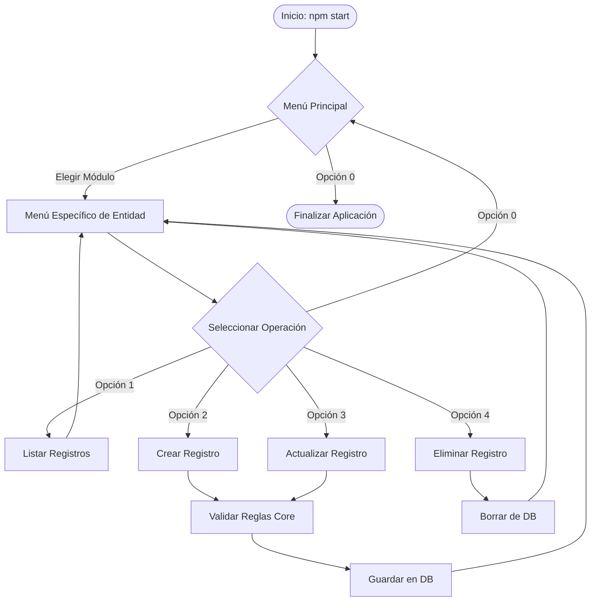

<div align="center">
  <h1>🏫 ACME School - CLI Management System</h1>
  <p><em>Aplicación modular en Node.js y MySQL para la gestión académica desde la consola.</em></p>
</div>

---

## 1. 📖 Descripción del Proyecto

**ACME School** es un potente sistema de administración escolar interactivo. Operado íntegramente desde la consola, permite gestionar estudiantes, profesores, asignaturas, horarios y calificaciones sin necesidad de una interfaz web compleja, destacando por su altísimo rendimiento y arquitectura modular en Node.js.

### Módulos Principales
| Módulo | Funcionalidad Clave |
| :--- | :--- |
| 👨‍🎓 **Estudiantes & Profesores** | Gestión integral de perfiles de usuarios y tipos de identificación. |
| 📚 **Cursos & Temarios** | Creación y estructuración de la malla curricular académica. |
| 🏢 **Aulas & Ciudades** | Administración de espacios físicos y sedes geográficas. |
| 📅 **Horarios & Matrículas** | Lógica avanzada de enrolamiento (valida conflictos de agenda). |
| 📝 **Calificaciones** | Registro de notas y retroalimentación para alumnos inscritos. |

---

## 2. 🛠 Requisitos Previos

Necesitas contar con el siguiente software en tu entorno local:
- 🟢 [Node.js](https://nodejs.org/es/) (Versión 16 o superior).
- 🐬 [MySQL Server](https://dev.mysql.com/downloads/mysql/) corriendo localmente o en la nube.
- 🐙 [Git](https://git-scm.com/) para el control de versiones.

---

## 3. 🚀 Guía de Instalación

Selecciona tu sistema operativo y ejecuta los siguientes comandos en tu terminal.

### 🪟 Windows (PowerShell / CMD)
```bash
# Clonar repositorio
git clone https://github.com/brandon-ixen/acme_school.git
# Entrar a la carpeta
cd acme_school
# Instalar dependencias
npm install
```

### 🐧 Linux / macOS (Terminal)
```bash
# Clonar repositorio
git clone https://github.com/brandon-ixen/acme_school.git
# Entrar a la carpeta
cd acme_school
# Instalar dependencias
npm install
```
> [!NOTE]
> *Consulta la [Guía Completa de Clonación](docs/clonacion.md) para más opciones.*

---

## 4. ⚙️ Configuración del Entorno y Base de Datos

1. Copia el archivo plantilla `.env.example` y renómbralo a `.env`.
2. Reemplaza las variables con tus accesos locales de MySQL:
   ```env
   DB_HOST=localhost
   DB_USER=root
   DB_PASSWORD=tu_contraseña_secreta
   DB_NAME=acme_school
   DB_PORT=3306
   ```
3. Ejecuta el script SQL incluido en la carpeta de base de datos dentro de tu cliente MySQL.
> [!IMPORTANT]
> *Consulta la [Guía de Configuración de BD](docs/configuracion_bd.md) detallada.*

---

## 5. 🎮 Cómo Correr la Aplicación

Con las dependencias instaladas y la base de datos conectada, lanza la aplicación:

```bash
npm start
```

### Interacción con los Menús
| Acción | Tecla a usar |
| :--- | :--- |
| **Navegar opciones** | Flechas arriba/abajo (`↑` `↓`) |
| **Confirmar selección** | Tecla Enter (`↵`) |
| **Regresar** | Selecciona `0. Volver al menú principal` |
| **Salir de la App** | En el menú principal, selecciona `0. Salir` |

---

## 6. 📁 Estructura del Proyecto

```text
acme_school/
├── .env                 # Variables de entorno secretas (Ignorado en Git)
├── .env.example         # Plantilla pública de variables de entorno
├── index.js             # Punto de arranque principal
├── package.json         # Dependencias del proyecto
├── docs/                # Documentación detallada
│   ├── clonacion.md
│   └── configuracion_bd.md
└── src/                 # Código Fuente
    ├── aplicacion/      # Controladores de Menús CLI (Inquirer)
    ├── doamin/          # Entidades Core y Validaciones de Reglas de Negocio
    └── infraestructura/ # Conexión a DB MySQL y Repositorios SQL
```

---

## 7. 🗄 Diagrama de Entidad-Relación (EER)

El núcleo relacional de la aplicación utiliza la tabla `courses_schedules` (Horarios) como pivote central, conectando **Profesores**, **Cursos** y **Aulas**. Los estudiantes se relacionan con estos horarios mediante la tabla `inscriptions` (Matrículas), asegurando integridad referencial en todo momento.

---

## 8. 🔄 Flujograma de la Aplicación



---

## 9. 🛠 Solución de Problemas (Troubleshooting)

| Error Común | Posible Causa | Solución Recomendada |
| :--- | :--- | :--- |
| `Access denied for user` | Contraseña incorrecta en `.env`. | Abre `.env` y verifica `DB_PASSWORD`. |
| `ECONNREFUSED 127.0.0.1:3306` | Servicio MySQL apagado. | Enciende tu servidor XAMPP, WAMP o Docker. |
| `Unknown database 'acme_school'` | Base de datos inexistente. | Ejecuta `CREATE DATABASE acme_school;` en MySQL. |
| `MODULE_NOT_FOUND` | Dependencias sin instalar. | Ejecuta `npm install` en la terminal. |
| Menú sin formato/colores rotos | Consola incompatible con ANSI. | Usa **Windows Terminal**, **PowerShell** o **iTerm2**. |

---

## 10. 📬 Información de Contacto

Aplicación estructurada mediante buenas prácticas de Ingeniería de Software y Arquitectura Limpia por:

💻 **Brandon Estiben Ixén Teleguario**  
🔗 **Perfil de GitHub:** [https://github.com/brandon-ixen](https://github.com/brandon-ixen)  
*(Desarrollador Backend & Software Engineer)*
